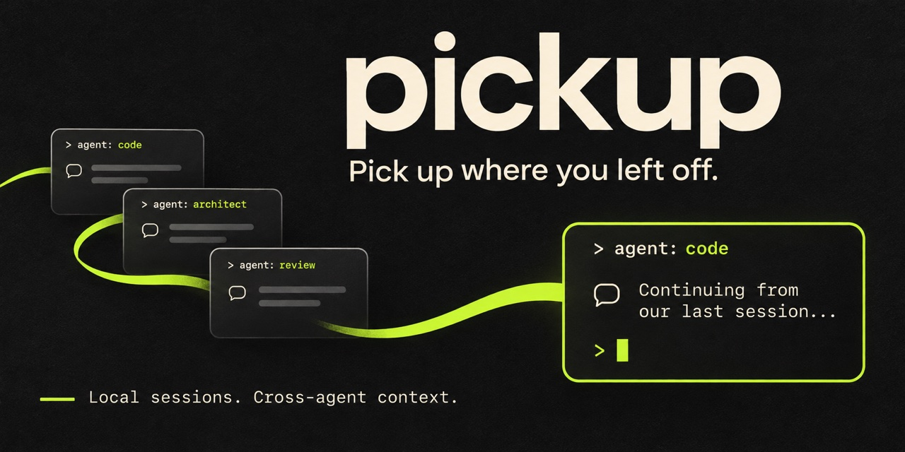

<div align="center">



# pickup

**Let an AI coding agent find and read another local session.**

*Cross-project, cross-tool local session discovery and progressive reading — zero format conversion, zero background daemons, zero third-party dependencies.*

<p>
  <a href="https://www.python.org/downloads/"></a>
  
  
  
  <a href="https://github.com/tt-a1i/pickup/commits/main"></a>
</p>

<p>
  <a href="README.md">简体中文</a> · <strong>English</strong>
</p>

</div>

---

## Why `pickup`?

You explored an architecture in **Antigravity** and want **Codex** to implement it — or a session in **Kimi Code** / **Qoder** stalled mid-task and you want to switch tools without losing context. All of that history is already sitting on your local disk; the new agent just needs a reliable way to locate and read it.

| Common pain point | How `pickup` solves it |
| :--- | :--- |
| Scattered session files & SQLite DBs tied to specific directories | **Global cross-tool discovery**: searches across 7 local agents regardless of `cwd`, by verbatim quote, title, or topic |
| Feeding a 3,000-step session from the top chokes or derails the model | **Progressive disclosure**: gives you the full user-prompt outline + tail turns first, then reads exact ranges or greps on demand |
| Heavy indexers, 2 GB duplicate DBs, or always-on MCP context bloat | **Zero daemon, zero index, read-only**: Python standard library only; never modifies source stores or sends network requests |
| Handoff tools forcing unsolicited next actions | **Strictly non-intrusive**: loads the history cleanly and lets your current prompt decide whether to summarize, rethink, or continue coding |

---

## Supported Agents

| Agent | Default Local Store | What `pickup` Reads |
| :--- | :--- | :--- |
| **Antigravity** | `~/.gemini/antigravity/` | Transcripts and recent task logs, with a read-only `conversations_fts` text fallback |
| **Codex** | `~/.codex/sessions/`, `~/.codex/archived_sessions/`, `~/.codex/thread_history_1.sqlite` | JSONL and `.jsonl.zst` rollouts, with a read-only SQLite dialogue fallback for missing rollouts |
| **Claude Code** | `~/.claude/projects/` | Project and nested subagent JSONL, including text blocks in tool results |
| **Qoder** | `~/.qoder/projects/`, `~/.qoder-cn/projects/`, `~/.qoderwork/projects/` | Active-branch dialogue and searchable branch history, including nested subagents |
| **Pi** | `~/.pi/agent/sessions/` | Reconstructs active branch via last persisted parent chain, keeping earlier turns along the path |
| **Kimi Code** | `~/.kimi-code/sessions/` | Committed main-agent messages, deduplicating replay events |
| **Devin CLI** | `~/.local/share/devin/cli/sessions.db` | Read-only SQLite query along the active message branch |

> Adapters reflect observed macOS storage formats. Paths and formats may work on other Unix-like systems but are not yet verified across OSes, and client updates may change formats over time. Cloud-only web sessions, binary attachments, and separate subagent histories are outside completeness guarantees.

---

## Installation

Requires **Python 3.10+**. Reading Zstandard-compressed Codex records requires Python 3.14's standard library or the system `zstd` command.

### 1. Clone and verify the CLI

```bash
git clone https://github.com/tt-a1i/pickup.git
cd pickup
python3 scripts/pickup.py --help
```

Optional shell alias in `~/.zshrc` or `~/.bashrc`:

```bash
alias pickup='python3 /absolute/path/to/pickup/scripts/pickup.py'
```

### 2. Install as an Agent Skill (Recommended)

From the repository root, run the commands for each client you use. Link the whole repository so both `SKILL.md` and `scripts/` are available. If the target already exists as a file, directory, or symlink, inspect and preserve it until you decide how to handle it; these commands will not overwrite it.

```bash
# Codex
mkdir -p ~/.codex/skills
test ! -e ~/.codex/skills/pickup && test ! -L ~/.codex/skills/pickup && ln -s "$PWD" ~/.codex/skills/pickup

# Claude Code
mkdir -p ~/.claude/skills
test ! -e ~/.claude/skills/pickup && test ! -L ~/.claude/skills/pickup && ln -s "$PWD" ~/.claude/skills/pickup

# Antigravity
mkdir -p ~/.gemini/config/skills
test ! -e ~/.gemini/config/skills/pickup && test ! -L ~/.gemini/config/skills/pickup && ln -s "$PWD" ~/.gemini/config/skills/pickup
```

Install separately for each client. In a new Codex App chat, type `$pickup` and select the skill. In Claude Code or Antigravity, enter `/pickup`. If the skill is missing, check that the link points to the repository containing `SKILL.md` and `scripts/`.

---

## Usage

Open a known ID or link directly with `show`. When a search result already gives a turn, run its `open match` command or use `read <uid> --turns X-Y`. Use the outline to choose turns when needed.

Run from the repository root (or replace `python3 scripts/pickup.py` with `pickup` if aliased).

### 1. Find candidates

```bash
# List the 6 most recently updated sessions across all agents and directories
python3 scripts/pickup.py

# Search by verbatim quote, title, or topic keyword
python3 scripts/pickup.py "distinctive phrase from the session"

# Narrow to a specific agent when known
python3 scripts/pickup.py --agent kimi
python3 scripts/pickup.py --agent devin "login timeout"
python3 scripts/pickup.py --agent codex --include-subagents "review findings"
python3 scripts/pickup.py --project archify --since 2026-11-01 --model astra "CI speed"

# Customize limit or exclude the current session explicitly
python3 scripts/pickup.py --limit 10
python3 scripts/pickup.py --exclude '<full-session-id-or-uid>'
```

- **Discovery only — never auto-loads #1**: without a query, candidates sort by file modification time; with a query, matches in parsed titles, summaries, and dialogue outrank tool-output matches.
- A local session ID supplied by the caller excludes the current session. Use `--exclude` when the environment has no ID. For Claude Code, a caller can supply `CLAUDE_SESSION_ID` from the hook input `session_id`. [Claude Code hooks](https://code.claude.com/docs/en/hooks#common-input-fields)
- Keyword matches include the source role, turn and text snippet to help assess candidates. `--agent` limits sources before discovery.
- `--project` matches workspace paths. `--since` includes records modified on or after the given local date. These filters can skip transcript reads when the relevant metadata is available. `--model` matches names recorded in Codex, Antigravity, Claude Code and Qoder transcripts, including sessions that switched models.
- Titles, workspace names and exact phrases in ordinary dialogue rank above pickup requests and tool output. A later user message ranks lower when it cites the matching assistant session or repeats a substantial part of the assistant reply. Use `open match` to read the passage.
- `Scan coverage` goes to stderr. Check `failed`, `discovery_failed`, `metadata_only`, `indexed_text`, `sqlite_history`, `unscanned` and any decode warnings. `prefiltered` counts files ruled out for the query. When this count is positive, the coverage status says that the raw prefilter skipped JSON validation for those files. Metadata-only records can still supply titles and workspace paths.

### 2. Inspect overview & outline (`show`)

```bash
python3 scripts/pickup.py show '<uid>'
python3 scripts/pickup.py show '<uid>' --tail 2
python3 scripts/pickup.py show 'codex://threads/<full-session-id>'
```

Returns an outline of user prompts, shortened recent turns, tool call summaries, and available errors or background task logs. When several files share a session ID, use the record UID with an `@` suffix from the candidate list or ambiguity message.

Open local Antigravity, Codex, Claude Code, and Qoder subagents by ID. Keyword searches and recent lists default to main sessions. Add `--include-subagents` to include subagents.

### 3. Read deeper on demand (`read`)

```bash
# Read dialogue and tool summaries from turn 1
python3 scripts/pickup.py read '<uid>' --all

# Read a specific turn range spotted in the outline
python3 scripts/pickup.py read '<uid>' --turns 8-20

# Search across dialogue and retained tool records inside one session
python3 scripts/pickup.py read '<uid>' --grep 'build'

# Include brief tool output snippets
python3 scripts/pickup.py read '<uid>' --turns 8-20 --with-tools
```

`--with-tools` adds brief snippets. For exact commands, exit codes, call IDs, or subagent spawns, inspect `source_file` or export the raw records if available.

`show` and `read` default to 8,000 UTF-8 bytes per page, including the header and footer. `--max-bytes` adjusts that limit. `--max-chars` alone sets a character limit of at least 1,024 and permits up to four bytes per character. Supply both flags to enforce both limits.

Follow each `Next:` command until the selected view reports `complete=yes`. The cursor restores view options, and the continuation command preserves custom page limits. If the source changes, run the printed `Restart with:` command. If tool output is clipped, use a smaller `--max-bytes` and capture the footer.

Qoder `show`, `read`, and Markdown export follow the active branch by default. Search and `read --grep` include historical branches. To read a match marked `off-branch`, add `--all-branches --turns X`. Variants of the same prompt share a turn number, and active branches may have gaps in turn numbers.

### 4. Export to a file (`export`)

```bash
python3 scripts/pickup.py export '<uid>' --output ~/Downloads/dialogue.md
python3 scripts/pickup.py export '<uid>' --turns 8-10 --turns 15 --output ~/Downloads/selected.md
python3 scripts/pickup.py export '<uid>' --format raw --output ~/Downloads/session.jsonl
```

Markdown export saves the full decoded dialogue and tool summaries. Add `--with-tools` for output snippets. Raw export copies the selected file's bytes. Keep the original extension, such as `.jsonl.zst` for compressed sources. For Kimi Code, the source is the main agent's wire log. For Devin CLI, the raw export is JSONL with the selected session's message nodes and active branch pointer. Choose a new output path.

If the transcript is missing, Antigravity can use indexed text from `conversations_fts` and Codex can use projected user and assistant messages from `thread_items`. Search, `show`, `read`, and Markdown export label the fallback. These records have no raw export or tool details. The Antigravity CLI binary step stores are outside this support.

### Using pickup in chat

- **`$pickup`** in Codex App or **`/pickup`** in Claude Code and Antigravity lists recent sessions.
- Add a clue such as “read the earlier discussion about login timeouts” to find and summarize the matching thread.
- **Paste a quote or screenshot + `continue from here`** — the agent extracts a distinctive clue, loads the source session, checks live disk files / `git status` if coding, and picks up cleanly.

---

## Scope & Limitations

- **Strict local read-only**: opens SQLite with `?mode=ro`, spawns no daemons, builds no duplicate index DB, and makes zero network requests. (Content passed to an LLM by your host agent remains subject to that agent's data handling.)
- **Search latency**: full-history text search can take time; use `--agent` to narrow the scan when the source is known.
- **Text matching**: search matches and ranks text; it is not semantic search. Try another exact phrase or keyword if needed. A failed source read means a lack of results does not establish that the session is absent locally.
- **Continuation boundary**: loading an old session does not authorize executing its old suggestions; continue only work requested now.
- **Pi branch resolution**: follows the parent chain from the last persisted node on disk; uncommitted in-memory branch switches cannot be inferred. Compaction summaries and summary-only sessions are preserved and searchable.
- **Devin CLI**: reads the local database only; does not access Devin's cloud web API or credentials.

---

## Development & Verification

```bash
python3 -m unittest discover -s tests -v
```

Automated tests run offline against temporary fixtures without personal session data.

```text
pickup/
├── SKILL.md                  # Agent skill instructions
├── assets/cover.jpg          # README cover banner
├── scripts/
│   ├── pickup.py             # Core CLI: discovery, show, paginated read & adapters
│   ├── pickup_extra.py       # SQLite stores, Kimi wire logs, Qoder branch graph
│   ├── pickup_paging.py      # Bounded pages and cursor recovery
│   ├── pickup_scan.py        # Text prefilter and scan coverage
│   └── pickup_pi.py          # Pi persisted-branch resolver
└── tests/                    # Offline automated tests
```
