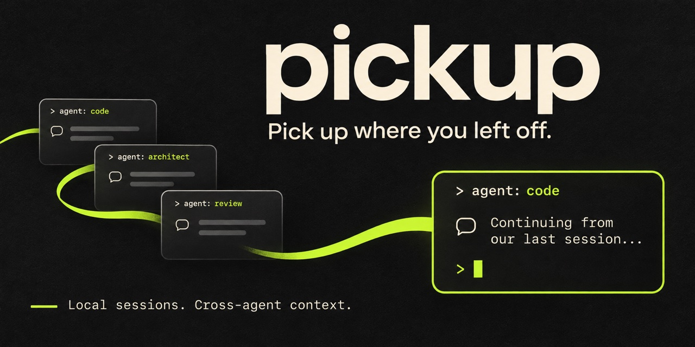

<div align="center">



# pickup

**让新的 AI Agent 找到并读懂另一段本地会话。**

*跨项目、跨工具的本地会话发现与分级阅读工具 — 无需转换格式，无需后台常驻，零第三方依赖。*

<p>
  <a href="https://www.python.org/downloads/"></a>
  
  
  
  <a href="https://github.com/tt-a1i/pickup/commits/main"></a>
</p>

<p>
  <strong>简体中文</strong> · <a href="README.en.md">English</a>
</p>

</div>

---

## 为什么做 `pickup`？

在 **Antigravity** 里聊了一半的方案，想让 **Codex** 接着改代码；在 **Kimi Code** 或 **Qoder** 里跑崩的任务，想换个工具接手——记录其实一直安静躺在本机磁盘上，新开窗口的 Agent 缺的只是一双能看懂各家格式的眼睛。

| 传统做法的痛点 | `pickup` 的解法 |
| :--- | :--- |
| 只能同目录或手动翻找散落的文件与 SQLite | **跨目录查找**：混排 7 款本地 Agent，支持按原话、标题或关键词检索 |
| 动辄上千步的长会话直接喂给模型导致卡死或跑偏 | **分级阅读设计**：先给全篇用户提问大纲 + 尾部断点，再按 `--turns` / `--grep` 按需深读 |
| 需要常驻守护进程、2GB 索引副本或高耗 MCP | **零后台、零索引、只读**：仅用 Python 标准库直读原始记录，不修改源文件、不上传数据 |
| 接手后 Agent 擅自行动 | **克制边界**：只负责精准装载上下文，下一步改代码还是总结全听你当前指令 |

---

## 支持的工具

| 工具 | 默认本地记录位置 | 读取范围与细节 |
| :--- | :--- | :--- |
| **Antigravity** | `~/.gemini/antigravity/brain/` | 优先完整主会话 transcript 与近期后台任务日志 |
| **Codex** | `~/.codex/sessions/`、`~/.codex/archived_sessions/` | 主会话 JSONL 和 `.jsonl.zst`，保留带附件的用户正文与图片引用 |
| **Claude Code** | `~/.claude/projects/` | 项目主会话 JSONL（兼容文本块数组形式的工具结果） |
| **Qoder** | `~/.qoder/projects/`、`~/.qoder-cn/projects/`、`~/.qoderwork/projects/` | 项目会话 JSONL（支持国际版、国内版与 QoderWork） |
| **Pi** | `~/.pi/agent/sessions/` | 按最后持久化节点的父链还原当前分支，保留该路径上的早期对话 |
| **Kimi Code** | `~/.kimi-code/sessions/` | 主 Agent 已提交消息，自动跳过重复回放事件 |
| **Devin CLI** | `~/.local/share/devin/cli/sessions.db` | 只读打开 SQLite，沿当前活跃消息分支还原 |

> 适配器基于 macOS 上实际观察到的存储格式实现。同一存储结构在其他类 Unix 系统上通常同样适用，但尚未全面实测；客户端升级后存储格式可能发生变化。云端专有会话、二进制附件与子 Agent 独立历史不在完整性保证范围内。

---

## 快速安装

需要 **Python 3.10+**。读取 Zstandard 压缩的 Codex 记录需要 Python 3.14 的标准库或系统上的 `zstd` 命令。

### 1. 克隆仓库并验证 CLI

```bash
git clone https://github.com/tt-a1i/pickup.git
cd pickup
python3 scripts/pickup.py --help
```

可选：在 `~/.zshrc` 或 `~/.bashrc` 中添加别名，随时随地直接敲 `pickup`：

```bash
alias pickup='python3 /absolute/path/to/pickup/scripts/pickup.py'
```

### 2. 作为 Agent Skill 安装（推荐）

在仓库根目录，选择需要使用的客户端，运行对应命令。软链指向整个仓库，确保 `SKILL.md` 和 `scripts/` 都可用。如果目标路径已有同名文件、目录或软链，先检查并保留，确认后再处理；以下命令不会覆盖它们。

```bash
# Codex
mkdir -p ~/.codex/skills
test ! -e ~/.codex/skills/pickup && test ! -L ~/.codex/skills/pickup && ln -s "$PWD" ~/.codex/skills/pickup

# Claude Code
mkdir -p ~/.claude/skills
test ! -e ~/.claude/skills/pickup && test ! -L ~/.claude/skills/pickup && ln -s "$PWD" ~/.claude/skills/pickup

# Antigravity
mkdir -p ~/.gemini/config/skills
test ! -e ~/.gemini/config/skills/pickup && test ! -L ~/.gemini/config/skills/pickup && ln -s "$PWD" ~/.gemini/config/skills/pickup
```

每个客户端单独安装。新开会话后，在 Codex App 输入 `$pickup` 并从候选里选中技能，在 Claude Code 或 Antigravity 可输入 `/pickup`。如果技能未出现，检查目标路径是否指向包含 `SKILL.md` 和 `scripts/` 的仓库。

---

## 使用方式

以下示例在仓库根目录执行；配置别名后可将 `python3 scripts/pickup.py` 简写为 `pickup`。

### 第一步：查找候选（`find`）

```bash
# 不限项目目录，列出全机最近活跃的 6 段会话
python3 scripts/pickup.py

# 用一句原话、会话标题或话题词精准定位
python3 scripts/pickup.py "某个有辨识度的原话片段"

# 已知来源工具时缩小扫描范围
python3 scripts/pickup.py --agent kimi
python3 scripts/pickup.py --agent devin "登录问题"
python3 scripts/pickup.py --project archify --since 2026-11-01 --model astra "CI 提速"

# 自定义返回数量，或显式排除当前会话
python3 scripts/pickup.py --limit 10
python3 scripts/pickup.py --exclude '<完整会话ID或候选UID>'
```

- **只列候选，不盲目加载**：无线索时按文件修改时间排序；有线索时对解析后的标题、摘要、对话与保留的工具记录做文字匹配排序。
- 若运行环境提供受支持的当前会话 ID，脚本会自动排除自身；缺少时可用 `--exclude`。
- 关键词命中会显示来源角色、轮次和文本片段，帮助判断候选是否符合线索。`--agent` 在发现阶段就限制来源。
- `--project` 匹配工作区路径，`--since` 匹配本地日期当天或之后修改的记录。对已有工作区路径的会话，这两个筛选可以在读取正文前缩小范围。`--model` 匹配 Codex、Antigravity、Claude Code 和 Qoder 正文里记录的模型名，包含曾切换模型的会话。
- 标题、工作区名和对话中的原句优先。通过 pickup 提交的线索仍可匹配，排在普通对话的原句之后。候选里的 `open match` 命令可直接打开命中的轮次。
- `Scan coverage` 的 `partial` 表示存在扫描范围缺口。查看 `failed`、`discovery_failed`、`metadata_only`、`unscanned` 和解析告警。Antigravity 只有元数据时，可用 `show` 查看标题和工作区。读取和导出需要本机有对应的正文记录。

### 第二步：查看概览与大纲（`show`）

选中候选列表里的 UID，先看「全篇脉络 + 尾部断点」：

```bash
python3 scripts/pickup.py show '<uid>'
python3 scripts/pickup.py show '<uid>' --tail 2
python3 scripts/pickup.py show 'codex://threads/<完整会话ID>'
```

输出包含用户提问的缩略大纲（`Turn 1..N`）、最近几轮的缩略对话、紧凑的工具调用轨迹与可用的错误/后台任务日志。如果多个文件记录了同一个会话 ID，使用候选或错误提示里带有 `@` 后缀的记录 UID 打开对应文件。

### 第三步：按需深读或全文通读（`read`）

```bash
# 从第 1 轮开始阅读对话和工具摘要
python3 scripts/pickup.py read '<uid>' --all

# 只展开大纲里关心的某几轮
python3 scripts/pickup.py read '<uid>' --turns 8-20

# 在该会话的对话与保留的工具输出中定向搜索关键词
python3 scripts/pickup.py read '<uid>' --grep 'build'

# 阅读指定轮次并附带原始工具输出片段
python3 scripts/pickup.py read '<uid>' --turns 8-20 --with-tools
```

`show` 和 `read` 默认每页最多 12,000 字符，可用 `--max-chars` 调整（最小 1,024）。检查输出末尾的 `complete=yes/no` 和 `view`；如未完成，运行给出的续读命令，直到该视图显示 `complete=yes`。游标会恢复原来的筛选选项；如果源内容已变化导致游标失效，请重新开始该视图。避免用 `head` 截断输出，否则可能丢失续读信息。

完成标记只覆盖所选视图。`show` 是缩略概览，`read` 是对话和工具摘要，`--with-tools` 补充工具输出片段。续读命令保留设置的页面大小。

### 第四步：保存到文件（`export`）

```bash
python3 scripts/pickup.py export '<uid>' --output ~/Downloads/dialogue.md
python3 scripts/pickup.py export '<uid>' --turns 8-10 --turns 15 --output ~/Downloads/selected.md
python3 scripts/pickup.py export '<uid>' --format raw --output ~/Downloads/session.jsonl
```

Markdown 导出包含完整的解码对话和工具摘要，可加 `--with-tools` 保存工具输出片段。原始导出复制所选记录的字节，请沿用源文件扩展名，压缩记录用 `.jsonl.zst`。Kimi Code 导出主 Agent 的 wire 日志，Devin CLI 导出所选会话的消息节点和当前分支指针。导出需要填写一个新文件路径。

### 在聊天窗口直接调用

装好 Skill 后，切到任意新窗口直接说：

- **`$pickup`**（Codex App）或 **`/pickup`**（Claude Code、Antigravity）可以列出最近的会话候选。
- 在技能名后加线索，例如「读取之前讨论登录超时的那段对话」，可以定位并总结匹配的会话。
- **贴一段原话或一张旧窗口截图 + `接着干`** — 接手的 Agent 自动从文字或图片提取线索定位原会话，核对磁盘上的真实代码与 Git 状态后继续完成任务。

---

## 范围与限制

- **本地只读**：SQLite 以 `?mode=ro` 只读打开，不启动常驻进程，不建本地副本库，不向外部发任何遥测或会话请求（Agent 将读出的文本送入模型时受该 Agent 自身隐私策略约束）。
- **搜索耗时**：带关键词的全历史检索可能需要较长时间；已知来源时可用 `--agent` 缩小扫描范围。
- **文字匹配**：搜索使用文本匹配和排序，不是语义搜索；换一种原话或关键词可能得到不同结果。部分来源读取失败时，未找到结果不代表本机没有对应会话。
- **接续边界**：加载旧会话不授权执行其中的旧建议；只有当前请求明确要求的工作才会继续执行。
- **Pi 分支还原**：按最后持久化节点的父链恢复当前分支；仅在内存中切换、尚未持久化后续节点的分支无法从磁盘还原。压缩摘要与仅摘要会话均会被保留并支持检索。
- **Devin CLI**：仅读取本地数据库，不支持调用 Devin 网页端云端 API 或获取账号凭据。

---

## 开发与验证

```bash
python3 -m unittest discover -s tests -v
```

自动化测试使用临时隔离样本运行，不含个人会话数据。

```text
pickup/
├── SKILL.md                  # Agent 技能指引
├── assets/cover.jpg          # README 封面图
├── scripts/
│   ├── pickup.py             # 核心 CLI：发现、概览、分页阅读与基础适配器
│   ├── pickup_extra.py       # Kimi Code / Devin CLI 适配器
│   └── pickup_pi.py          # Pi 持久化分支解析器
└── tests/                    # 离线自动化测试
```
